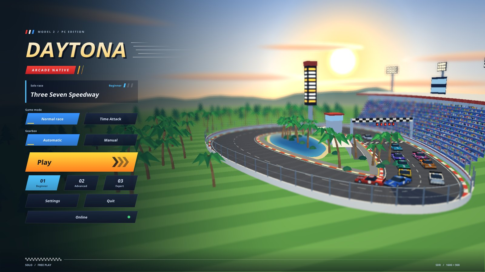

# Daytona Reborn

**Daytona USA (Sega Model 2, 1994) rebuilt as native code for the PC, with
online play for up to 8 players.**

The arcade's programs are statically recompiled to portable C++: the i960
game code, the TGP program it uploads and the sound board's 68000 code. The
rest of the board (geometrizer, rasterizer, tilemaps, sound chips) is native
C++. No emulator and no interpreter run while you play; MAME is used only as
a test oracle. No game data is in this repository: you build the game from
your own ROM set.

This repository is a fork of [Daytona Reborn](https://github.com/yodo113/Daytona-Reborn-Beta)
by yodo113, itself built on [daytona-arcade-recomp](https://github.com/alphanu1/daytona-arcade-recomp)
by alphanu1. What it adds is listed in [CHANGELOG.md](CHANGELOG.md).

## Highlights

- **Online mode.** Race friends over the Internet, up to 8 players a room,
  through a small relay server you can run in Docker. Create a room, send the
  invite code, and start the race when your friends are in (who comes later
  races the next one): the cabinets' settings, the start and the course
  choice are synchronised; the
  players' names and live standings show over the race, and each other
  player's name rides above their car. No router port to open. Rooms of 8
  linked cabinets have been run through the relay. See
  [server/daytona-relay](server/daytona-relay/README.md).
- **A web page for the server**, in the game's style: see the open rooms and
  create rooms with their own race settings (difficulty, game mode, who may
  start...), with an invite code ready to copy.
- **A PC home menu** (Revision A) over an animated sunset speedway: solo
  race or Time Attack, the course, automatic or manual gearbox, Settings,
  Online.
- **Enhancements, off by default:** widescreen 16:10, 16:9 or 21:9, a longer
  draw distance, 3D scenery, always-detailed opponents, arcade screen
  colours, 120 frames/s smoothing (experimental).
- **Controls** for keyboard, gamepads, wheels and pedals, with analogue axes
  and force feedback (experimental).
- **Languages:** English, French, Brazilian Portuguese.
- **Link play** over a local network, as linked arcade cabinets.

## Quick start

You need your own ROM set in MAME format (`.zip` or `.7z`):

| Set | Game | Notes |
| --- | --- | --- |
| `daytona` | Daytona USA, Revision A (1994) | PC home menu, enhancements, Online and link play |
| `daytona93` | Daytona USA Deluxe '93 | optional, built as a separate game |

1. Get the code:

       git clone https://github.com/railton/daytona-reborn.git
       cd daytona-reborn

2. Copy your ROM set to `roms/daytona.zip` (and/or `roms/daytona93.zip`).
3. Build:

   | System | Command |
   | --- | --- |
   | Windows (PowerShell) | `powershell -ExecutionPolicy Bypass -File setup.ps1` |
   | Linux, with Docker (nothing else installed) | `./scripts/docker-build.sh` |
   | Linux or macOS, native | `./setup.sh` |

   Setup installs the toolchain, fetches the pinned dependencies into
   `extern/`, recompiles the game from your ROM set, builds and runs the
   tests.
4. Play: `build-daytona/daytona` (`build-daytona\Release\daytona.exe` on
   Windows; setup prints the exact path).

Step by step, with the usual problems and fixes:
[docs/BUILDING.md](docs/BUILDING.md). More detail on every platform and option:
[docs/getting-started.md](docs/getting-started.md).

**Updating:** `git pull`, then run the build again (updates can change the
generated code, which is rebuilt from your ROM set). **Never share your
builds:** they contain code generated from the ROM.

## Playing

The Revision A game opens on its home menu. **Settings** has six tabs:

| Tab | What it holds |
| --- | --- |
| Game | the ROM set (Browse, Check) |
| Display | picture format, graphics API, renderer, render resolution, draw mode, fullscreen, display pacing |
| Enhancements | draw distance, 3D scenery, opponents' detail, polygon budget, widescreen options, screen colours, smoothing |
| Link play | linking cabinets on a local network |
| Controls | devices, steering, force feedback, every control's key, gamepad and wheel assignment |
| Sound | volume, music and effects balance, native sound |

The language is chosen at the top right. Settings are saved as they change,
in your user data folder (`launcher.ini`).

Default controls:

| Control | Keyboard | Gamepad |
| --- | --- | --- |
| Steer | Left / Right | Left stick (analogue) |
| Accelerate / brake | Up / Down | Right / left trigger (analogue) |
| Gears 1-4 | 1 2 3 4 | |
| View buttons VR1-VR4 | A S D F | Face buttons |
| Shift up / down | W / Q | Right / left shoulder |
| Coin / start | 5 / Enter | Back / Start |
| Test / service | F2 / F3 | |
| Fullscreen / menu | F11 / Esc | |
| Players list (Online) | Tab | Left stick button |

Command line: `--rom FILE.zip`, `--fullscreen`, `--gpu vulkan|direct3d12|metal`,
`--audio native|reference`, `--profile NAME` (separate settings and saves,
e.g. a second player on the same computer), `--online`, `--settings`,
`--arcade` (the cabinet launcher instead of the home menu), `--autostart`.

## Online play

1. Someone runs the relay server (`server/daytona-relay`,
   `docker compose up -d --build`; TCP port 7777 for the games, 8080 for its
   web page). Its environment variables set the race for rooms the games
   create; rooms created on the web page carry their own settings.
2. In the home menu, **Online**: type your name and the server, **Create the
   room**, and send the invite code. Or create the room on the server's web
   page and share the code it shows. A room takes up to 8 players.
3. Friends paste the code under **Join a room**. The room's owner presses
   **Start the race** when everyone is in; in the race the owner presses
   Start and chooses the course, the others follow. Who joins later waits
   for the next race (**New race with everyone**).
4. In the race, the players list (first 10 s, then hold Tab) shows the live
   standings, and a tag with each player's name floats above their car. When
   the race ends the games return to the attract screen still linked: the
   first player presses Start again for the next race.

Details, settings and the protocol: [server/daytona-relay/README.md](server/daytona-relay/README.md).
Not yet tried between distant networks; see the known limits in
[CHANGELOG.md](CHANGELOG.md).

## Link play on a local network

Revision A can link cabinets over a LAN, as linked arcade machines. In
Settings > **Link play**, tick **Link to other cabinets**, give this
cabinet's port and the next cabinet's `host:port` (the cabinets form a ring;
with two, each one's next is the other); then in the test menu (F2) >
GAME SYSTEM set **LINK ID** (one MASTER, the others SLAVE) and a different
**CAR NUMBER** on each. The Online mode does all of this on its own.

## Platforms

| Platform | Status | Details |
| --- | --- | --- |
| Windows, macOS, Linux | The main build | [docs/BUILDING.md](docs/BUILDING.md), [docs/getting-started.md](docs/getting-started.md) |
| Android | Works (arm64), touch controls or a controller | [platform/mobile](platform/mobile/README.md) |
| iOS | Works on iPhone (Xcode or AltStore), touch controls or a controller | [platform/mobile](platform/mobile/README.md) |
| PS Vita | Works, about 57.3 frames/s with vitaGL (the arcade runs 57.52) | [platform/vita](platform/vita/README.md), [HOW_TO_COMPILE_RELEASE.md](HOW_TO_COMPILE_RELEASE.md) |
| Dreamcast | In progress: runs in the Flycast emulator, about 32 frames/s | [platform/dreamcast](platform/dreamcast/README.md) |

Every port starts from the desktop build: the game code is generated on a
desktop computer from your ROM set, then built for the other platform.

## For developers

- Design: [docs/daytona-usa-recomp-design.md](docs/daytona-usa-recomp-design.md);
  project rules: [rules.md](rules.md).
- Tests: `ctest` in the build folder (C++); `go test ./...` in
  `server/daytona-relay`.
- After changing a recompiler or the seeds: `python3 scripts/recompile.py`
  (`--set daytona --build-dir build-daytona` for Revision A).
  `--fast_inaccuracy` trades exact interrupt timing for speed (used on the
  PS Vita).
- Interface texts are written in English with `TX("...")`; run
  `python3 scripts/extract_strings.py` and fill `lang/fr.po` and
  `lang/pt.po`.
- Headless tools: `m2run` (with `--relay` to join an Online room),
  `m2gpushot`, and `daytona --capture-home FILE.bmp` for the interface.

## Licence

This project's own code is under the [BSD-3-Clause licence](LICENSE).
Code from other projects keeps its own licence and notices; see
[THIRD_PARTY.md](THIRD_PARTY.md). The licence does not cover Daytona USA
itself: the ROMs and the code generated from them are never distributed.
Daytona USA is a trademark of its owner; this project is not affiliated with
it.
