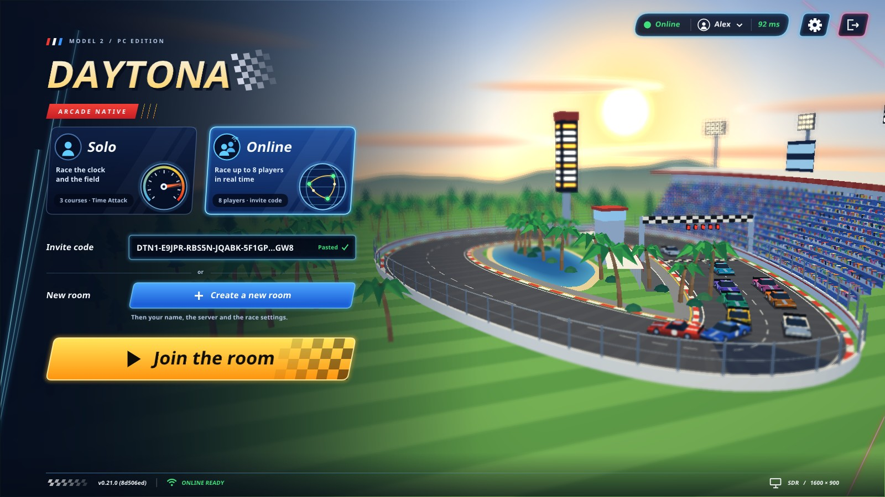
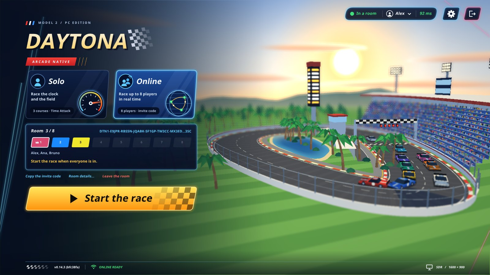
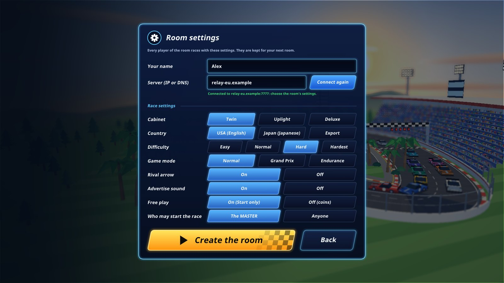
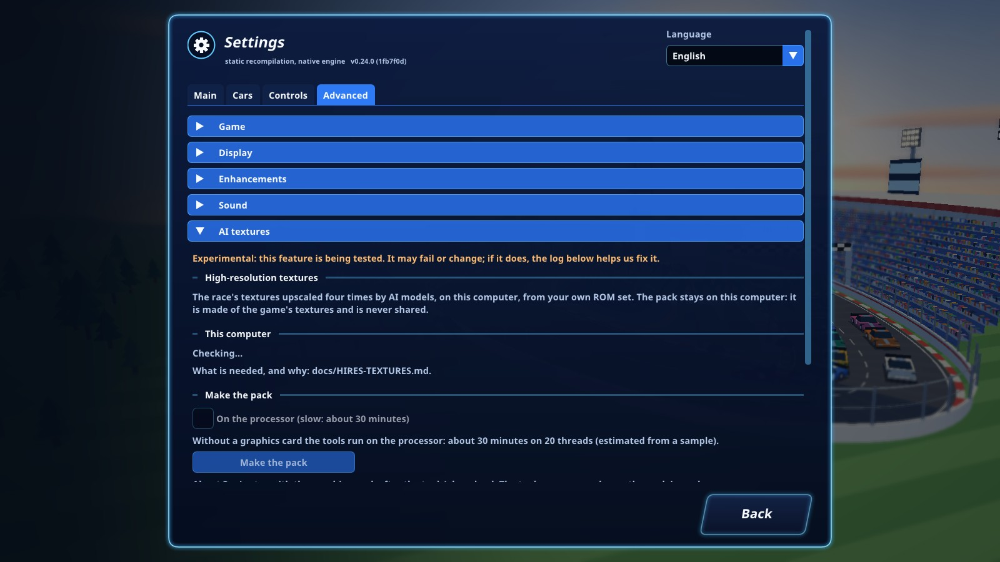

# Daytona Reborn

**English** · [Português (Brasil)](README.pt-BR.md)

**Daytona USA (Sega Model 2, 1994) rebuilt as native code for the PC, with
online play for up to 8 players.**

The arcade's programs are statically recompiled to portable C++: the i960
game code, the TGP program it uploads and the sound board's 68000 code. The
rest of the board (geometrizer, rasterizer, tilemaps, sound chips) is native
C++. No emulator and no interpreter run while you play; MAME is used only as
a test oracle. No game data is in this repository: you build the game from
your own ROM set.

This repository is a fork of [Daytona Reborn](https://github.com/yodo113/Daytona-Reborn-Beta)
by yodo113, itself built on [daytona-arcade-recomp](https://github.com/alphanu1/daytona-arcade-recomp)
by alphanu1. What it adds is listed in [CHANGELOG.md](CHANGELOG.md).

## Change Logs

**`2026-11-25`** **0.21.0**: make the high-resolution texture pack from **Settings > AI textures** (Linux with Docker, NVIDIA or the processor); the home screen tells when a [new version](#new-versions) is out; Windows build fixes; follow-ups of an external graphics review (detail fading in, smoother edge HUD, steadier shadows, a 10x faster pack refresh).

**`2026-11-25`** **0.20.0**: **Smooth menus and HUD**: the game's 2D pictures with smooth curves at high resolution, colours and dithering kept.

**`2026-11-25`** **0.19.0**: **High-resolution textures** (experimental): the race's textures upscaled 4x by AI models on your computer, from your ROM set. See [docs/HIRES-TEXTURES.md](docs/HIRES-TEXTURES.md).

**`2026-11-25`** **0.18.0**: Online: the course and gearbox choices come only from the race's master (the relay needs updating); car shadows in two cascades, so the opponents ahead cast them too.

**`2026-11-25`** **0.17.0**: Image enhancements: bloom, an arcade monitor (CRT) look, paint reflecting the course's real sky, car shadows, and **automatic quality**, which measures the graphics card at the first start.

**`2026-11-24`** **0.16.0**: Online server: abuse limits and a lighter relay.

**`2026-11-24`** **0.15.0**: Online: a start that no longer looks frozen, Esc pauses without stopping the race, the master chooses the gearbox, a chime when a player joins; **Generate logs** in Settings > Game.

**`2026-11-24`** **0.14.0** to **0.14.5**: The PC home redesigned in a neon look over an animated speedway; Settings and room details in the same look; Windows paths with accents.

**`2026-11-24`** **0.13.0**: Online across continents: a star relay, race data also by UDP, a dropped player back in the race, everyone starting together.

**`2026-11-24`** **0.12.0**: Online cars no longer flicker; **`Build Daytona.bat`** builds on Windows with nothing to install; the ROM set chosen on the first screen.

**`2026-11-24`** **0.11.0**: Online rooms of 4 to 8 across continents without slow motion; the version on the home screen; course and gearbox chosen with keys or a gamepad.

Everything, with measurements and known limits: [CHANGELOG.md](CHANGELOG.md).

## Original project documentation

From Daytona Reborn beta 0.10, kept in this repository:

- Install and play: [English](docs/INSTALLATION-EN.md) · [Français](docs/INSTALLATION-FR.md)
- Beta 0.10 release notes: [English](docs/NOTES-BETA-EN.md) · [Français](docs/NOTES-BETA-FR.md)
- Setup guide: [docs/getting-started.md](docs/getting-started.md), and its
  [troubleshooting](docs/getting-started.md#troubleshooting)

## Highlights

- **Online mode.** Race friends over the Internet, up to 8 players a room,
  through a small relay server you can run in Docker. Create a room, send the
  invite code, and start the race when your friends are in (who comes later
  races the next one): the cabinets' settings, the start and the course
  choice are synchronised; the
  players' names and live standings show over the race, and each other
  player's name rides above their car. No router port to open; a dropped
  connection comes back to the race on its own. Rooms of 8
  linked cabinets have been run through the relay. See
  [server/daytona-relay](server/daytona-relay/README.md); how to play:
  [docs/PLAYING-ONLINE.md](docs/PLAYING-ONLINE.md).
- **A PC home menu** (Revision A) over an animated sunset speedway, in a
  neon look: two cards, **Solo** (the cabinet's language and difficulty,
  then, as at the arcade, the course, the gearbox and Time Attack chosen on
  the game's own screens) and **Online** (join with an invite code, pasted on its
  own from the clipboard, or create a room); the player's name, the server's
  state and latency at the top, beside Settings and Quit. Settings and the
  room's settings open as neon panels over the speedway.
- **Enhancements, off by default:** widescreen 16:10, 16:9 or 21:9, a longer
  draw distance, 3D scenery, always-detailed opponents, arcade screen
  colours, 120 frames/s smoothing (experimental).
- **Image quality on the graphics card:** antialiasing, anisotropic
  filtering, the screen's own resolution (Direct3D 12 and Vulkan), smooth
  car shading, paint reflecting the course's sky, car shadows, bloom and an
  arcade monitor (CRT) look, smooth menus and HUD (the 2D pictures with
  smooth curves at high resolution). At the first start the game measures the
  graphics card and recommends a level; the player picks.
- **High-resolution textures (experimental):** the game's textures upscaled
  4x by AI models on your own computer, from your own ROM set, each by the
  model best at its kind (lettering, natural surfaces, the road); cut-out
  textures keep crisp outlines. Made from Settings > AI textures (Linux with
  Docker for now); what it needs: [docs/HIRES-TEXTURES.md](docs/HIRES-TEXTURES.md).
- **A custom body for your car (experimental):** a body you made (or
  converted from a model you may use) in place of your car's, lit by the
  game's light, on the game's wheels or its own; see
  [docs/CUSTOM-CARS.md](docs/CUSTOM-CARS.md), and how one was made:
  [docs/CUSTOM-CAR-WORKFLOW.md](docs/CUSTOM-CAR-WORKFLOW.md).
- **Controls** for keyboard, gamepads, wheels and pedals, with analogue axes
  and force feedback (experimental).
- **Languages:** English, French, Brazilian Portuguese.
- **Link play** over a local network, as linked arcade cabinets.

## Quick start

You need your own ROM set in MAME format (`.zip` or `.7z`):

| Set | Game | Notes |
| --- | --- | --- |
| `daytona` | Daytona USA, Revision A (1994) | PC home menu, enhancements, Online and link play |
| `daytona93` | Daytona USA Deluxe '93 | optional, built as a separate game |

1. Get the code:

       git clone https://github.com/railton/daytona-reborn.git
       cd daytona-reborn

   (or download the code as a zip and unzip it).
2. Build for your system, below. Each way fetches the pinned dependencies
   into `extern/`, recompiles the game from your ROM set and builds it (10
   to 40 minutes the first time). The game finds `roms/daytona.zip` by
   itself.

### Windows 10/11

| How | |
| --- | --- |
| **Recommended:** double-click **`Build Daytona.bat`** | portable tools downloaded and checked by SHA-256, nothing installed, no administrator; asks for your ROM set |
| With Visual Studio: `powershell -ExecutionPolicy Bypass -File setup.ps1` | installs Microsoft's build tools with winget; copy your ROM set to `roms\daytona.zip` first |

The game: `build-daytona\daytona.exe`, and a **Daytona (recomp)** shortcut
on the desktop.

### macOS (Apple Silicon or Intel)

| How | |
| --- | --- |
| **Recommended:** double-click **`Build Daytona.command`** | Apple's command line tools, portable CMake and Ninja checked by SHA-256, no Homebrew, no administrator; asks for your ROM set |
| Native, with Homebrew or MacPorts: `./setup.sh` | copy your ROM set to `roms/daytona.zip` first |

The game: `build-daytona/daytona`, and a **Daytona (recomp)** app on the
desktop (with `Build Daytona.command`).

### Linux

| How | |
| --- | --- |
| **Recommended:** with Docker, nothing else installed: `./scripts/docker-build.sh` | copy your ROM set to `roms/daytona.zip` first |
| Native: `./setup.sh` | installs the packages with apt, dnf, pacman or zypper (sudo) |
| A build for your own Windows PC: `./scripts/docker-build-windows.sh` | after `docker-build.sh`; copy `build-windows/` to the PC |

The game: `build-daytona/daytona`.

Step by step, with the usual problems and fixes:
[docs/BUILDING.md](docs/BUILDING.md). More detail on every platform and option:
[docs/getting-started.md](docs/getting-started.md).

**Updating:** get the new version (`git pull`, or download the new source
zip and unzip it over the old folder), then build again the same way (updates can
change the generated code, which is rebuilt from your ROM set; the tools in
`.tools/`, `extern/` and your `roms/` are kept). **Never share your
builds:** they contain code generated from the ROM.

## Playing

The Revision A game opens on its home menu. **Settings** has eight tabs:

| Tab | What it holds |
| --- | --- |
| Game | the ROM set (Browse, Check); logs (Generate logs, on by default; Open the logs folder); updates (check for new versions) |
| Display | picture format, graphics API, renderer, render resolution, draw mode, fullscreen, display pacing |
| Enhancements | draw distance, 3D scenery, opponents' detail, polygon budget, widescreen options, image quality (automatic or each option), smooth menus and HUD, screen effects, screen colours, smoothing |
| Cars | experimental: the car you drive, a card with a picture for each (the game's own, or a body made from a 3D model, [docs/CUSTOM-CARS.md](docs/CUSTOM-CARS.md)); it changes at once |
| Link play | linking cabinets on a local network |
| Controls | devices, steering, force feedback, every control's key, gamepad and wheel assignment |
| AI textures | experimental: what this computer has for the high-resolution texture pack, making it, using or deleting it ([docs/HIRES-TEXTURES.md](docs/HIRES-TEXTURES.md)) |
| Sound | volume, music and effects balance, native sound |

When something goes wrong, the game's log tells what happened: send
**daytona.log** (Settings > Game > **Open the logs folder**; the five
sessions before it are kept too).

The language is chosen at the top right. Settings are saved as they change,
in your user data folder (`launcher.ini`).

Default controls:

| Control | Keyboard | Gamepad |
| --- | --- | --- |
| Steer | Left / Right | Left stick (analogue) |
| Accelerate / brake | Up / Down | Right / left trigger (analogue) |
| Gears 1-4 | 1 2 3 4 | |
| View buttons VR1-VR4 | A S D F | Face buttons |
| Shift up / down | W / Q | Right / left shoulder |
| Coin / start | 5 / Enter | Back / Start |
| Test / service | F2 / F3 | |
| Fullscreen / menu | F11 / Esc | |
| Players list (Online) | Tab | Left stick button |

Command line: `--rom FILE.zip`, `--fullscreen`, `--gpu vulkan|direct3d12|metal`,
`--audio native|reference`, `--profile NAME` (separate settings and saves,
e.g. a second player on the same computer), `--online`, `--settings`,
`--arcade` (the cabinet launcher instead of the home menu), `--autostart`.

## Screenshots

The PC home and its screens (Revision A). Every picture is the application's
own interface and its 3D speedway, captured with `--capture-home`; no game
frame is shown.

| | |
| --- | --- |
|  |  |
| **Online**: the invite code is pasted on its own; or create a room. | **In a room**: its places in the cars' colours, what it waits for. |
|  |  |
| **Room settings**: name, server, and the race for every player. | **Settings**: display, enhancements, controls, AI textures, sound. |
|  | |
| **AI textures** (experimental): make the high-resolution texture pack on this computer. | |

## New versions

Once a day the home screen asks GitHub whether a newer release is out and,
if so, says which. Games are never distributed: to update, pull the source
(`git pull`, or download it again) and build again with your own ROM set.
The check sends nothing about you; turn it off in Settings > Game > Updates.

## Online play

**Step by step, with pictures: [docs/PLAYING-ONLINE.md](docs/PLAYING-ONLINE.md).**

1. Someone runs the relay server (`server/daytona-relay`,
   `docker compose up -d --build`; port 7777, TCP and UDP). Its environment
   variables are the race settings' defaults.
2. In the home menu, the **Online** card, **Create a new room**: the room's
   settings screen asks for your name and the server, connects, and shows
   the race settings (difficulty, game mode, who may start...) as choices
   that light up; **Create the room**, then **Copy the invite code** and send
   it. A room takes up to 8 players.
3. Friends copy the code: the Online card pastes it on its own (**Pasted**),
   and **Join the room** (the name is asked once). The home screen shows the
   room: its eight places in the cars' colours, the owner crowned, what it
   waits for; **Room details...** lists each player's latency to the server
   (green, yellow, red). The room's owner presses **Start the race** when
   everyone is in; in the race the owner presses Start and chooses the
   course and the gearbox, the others' screens follow and confirm with the
   owner's. Who joins later waits for the next race
   (**New race with everyone**).
4. In the race, the players list (first 10 s, then hold Tab) shows the live
   standings, and a tag with each player's name floats above their car. When
   the race ends the games return to the attract screen still linked: the
   first player presses Start again for the next race.

The link data is compressed: about 0.1 to 0.3 Mbit/s each way a player
(2 to 8 players) instead of 3.3. Rooms work across continents: the server
sends each player every other car's latest data in one hop, the race data
also goes by UDP to get through packet loss (TCP alone when UDP is
blocked), the games start the race together and keep the game's speed when
the network jitters, and a player whose connection drops comes back to the
race on their own within 10 s. 4 players from Brazil through a server in
Europe: the farthest car about 0.4 s old instead of 1 s; with 1% packet
loss on a test line the other cars move smoothly in 99% of the frames.
How it works, with diagrams: [docs/ONLINE-PROTOCOL.md](docs/ONLINE-PROTOCOL.md).
The server's settings and byte formats:
[server/daytona-relay/README.md](server/daytona-relay/README.md).
Not yet tried between distant networks; see the known limits in
[CHANGELOG.md](CHANGELOG.md).

## Link play on a local network

Revision A can link cabinets over a LAN, as linked arcade machines. In
Settings > **Link play**, tick **Link to other cabinets**, give this
cabinet's port and the next cabinet's `host:port` (the cabinets form a ring;
with two, each one's next is the other); then in the test menu (F2) >
GAME SYSTEM set **LINK ID** (one MASTER, the others SLAVE) and a different
**CAR NUMBER** on each. The Online mode does all of this on its own.

## Platforms

| Platform | Status | Details |
| --- | --- | --- |
| Windows, macOS, Linux | The main build | [docs/BUILDING.md](docs/BUILDING.md), [docs/getting-started.md](docs/getting-started.md) |
| Android | Works (arm64), touch controls or a controller | [platform/mobile](platform/mobile/README.md) |
| iOS | Works on iPhone (Xcode or AltStore), touch controls or a controller | [platform/mobile](platform/mobile/README.md) |
| PS Vita | Works, about 57.3 frames/s with vitaGL (the arcade runs 57.52) | [platform/vita](platform/vita/README.md), [HOW_TO_COMPILE_RELEASE.md](HOW_TO_COMPILE_RELEASE.md) |
| Dreamcast | In progress: runs in the Flycast emulator, about 32 frames/s | [platform/dreamcast](platform/dreamcast/README.md) |

Every port starts from the desktop build: the game code is generated on a
desktop computer from your ROM set, then built for the other platform.

## For developers

- Design: [docs/daytona-usa-recomp-design.md](docs/daytona-usa-recomp-design.md);
  project rules: [rules.md](rules.md).
- Version: `VERSION` (`MAJOR.MINOR.PATCH`), raised with every code change
  and listed in `CHANGELOG.md`; the home screen shows it with the commit
  the build came from.
- Tests: `ctest` in the build folder (C++); `go test ./...` in
  `server/daytona-relay`.
- After changing a recompiler or the seeds: `python3 scripts/recompile.py`
  (`--set daytona --build-dir build-daytona` for Revision A).
  `--fast_inaccuracy` trades exact interrupt timing for speed (used on the
  PS Vita).
- Interface texts are written in English with `TX("...")`; run
  `python3 scripts/extract_strings.py` and fill `lang/fr.po` and
  `lang/pt.po`.
- Headless tools: `m2run` (with `--relay` to join an Online room),
  `m2gpushot` (frames through the hardware renderer; `--hires-textures
  PACK`, `--smooth-2d`; `--bench` reports the frame time's median, p95 and
  p99), `m2texcap` (the textures a session uses, for a high-resolution
  pack), `daytona --make-hires-pack` (the AI textures tab's job without the
  window), and `daytona --capture-home FILE.bmp` for the interface.

## Licence

This project's own code is under the [BSD-3-Clause licence](LICENSE).
Code from other projects keeps its own licence and notices; see
[THIRD_PARTY.md](THIRD_PARTY.md). The licence does not cover Daytona USA
itself: the ROMs and the code generated from them are never distributed.
Daytona USA is a trademark of its owner; this project is not affiliated with
it.
