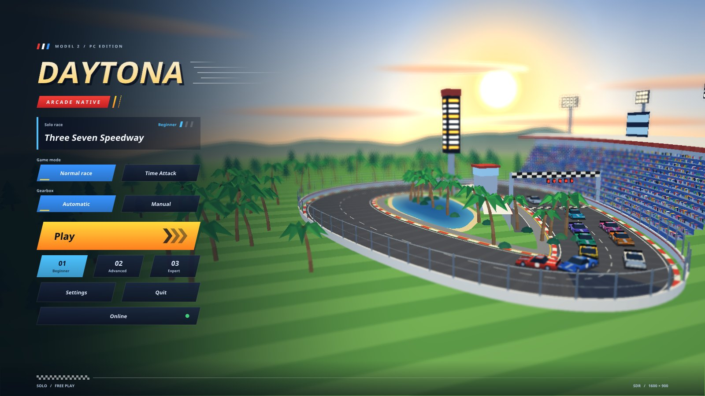
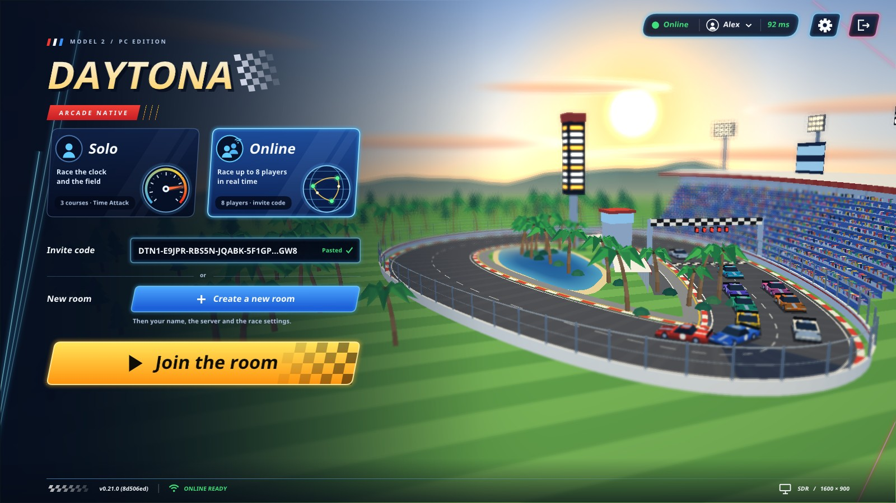
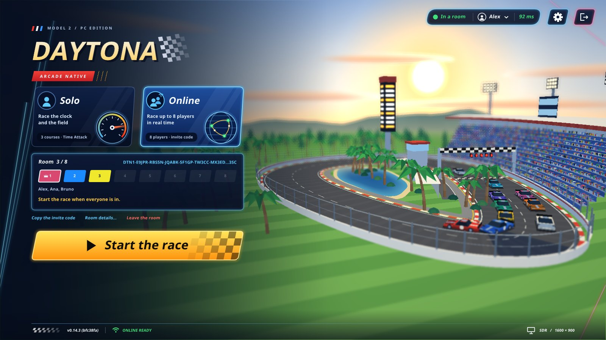
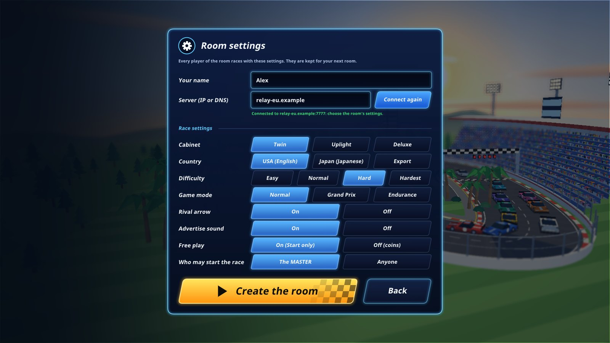
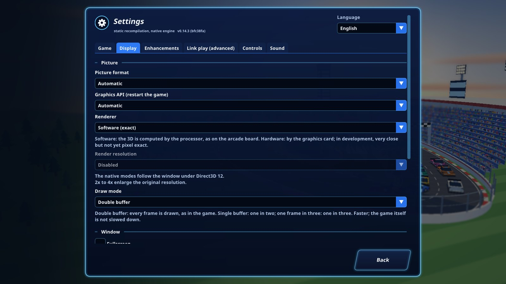

# Daytona Reborn

[English](README.md) · **Português (Brasil)**

**Daytona USA (Sega Model 2, 1994) reconstruído como código nativo para PC,
com jogo online para até 8 jogadores.**

Os programas do fliperama são recompilados estaticamente para C++ portável:
o código do jogo no i960, o programa que ele envia ao TGP e o código 68000
da placa de som. O resto da placa (geometrizador, rasterizador, tilemaps,
chips de som) é C++ nativo. Nenhum emulador e nenhum interpretador rodam
enquanto você joga; o MAME é usado só como referência nos testes. Nenhum
dado do jogo está neste repositório: você compila o jogo a partir da sua
própria ROM.

Este repositório é um fork do [Daytona Reborn](https://github.com/yodo113/Daytona-Reborn-Beta)
de yodo113, que por sua vez se baseia no [daytona-arcade-recomp](https://github.com/alphanu1/daytona-arcade-recomp)
de alphanu1. O que ele acrescenta está no [CHANGELOG.md](CHANGELOG.md) (em
inglês).

> Esta é uma tradução do [README em inglês](README.md), que é o original e o
> mais atualizado. Os demais documentos do projeto estão em inglês.

## Histórico de mudanças

**`2026-11-25`** **0.21.0**: gere o pacote de texturas em alta resolução em **Configurações > Texturas IA** (Linux com Docker, placa NVIDIA ou processador); a tela inicial avisa quando sai uma [nova versão](#novas-versões); correções do build no Windows; melhorias apontadas por uma revisão gráfica externa (detalhe que surge aos poucos, HUD nas bordas suave, sombras mais estáveis, reconferência do pacote 10 vezes mais rápida).

**`2026-11-25`** **0.20.0**: **Menus e HUD suaves**: as imagens 2D do jogo com curvas suaves em alta resolução, mantendo as cores e o pontilhado.

**`2026-11-25`** **0.19.0**: **Texturas em alta resolução** (experimental): as texturas da corrida ampliadas 4 vezes por modelos de IA no seu computador, a partir da sua ROM. Veja [docs/HIRES-TEXTURES.md](docs/HIRES-TEXTURES.md).

**`2026-11-25`** **0.18.0**: Online: a escolha da pista e do câmbio vem só do master da corrida (o relay precisa ser atualizado); sombras dos carros em duas faixas, para os adversários à frente também projetarem sombra.

**`2026-11-25`** **0.17.0**: Melhorias de imagem: bloom, visual de monitor de fliperama (CRT), pintura refletindo o céu real da pista, sombras dos carros e **qualidade automática**, que mede a placa de vídeo na primeira abertura.

**`2026-11-24`** **0.16.0**: Servidor online: limites contra abuso e um relay mais leve.

**`2026-11-24`** **0.15.0**: Online: a largada não parece mais travada, o Esc pausa sem encerrar a corrida, o master escolhe o câmbio, um aviso sonoro quando alguém entra na sala; **Gerar logs** em Configurações > Jogo.

**`2026-11-24`** **0.14.0** a **0.14.5**: A tela inicial redesenhada em visual neon sobre um autódromo animado; Configurações e detalhes da sala no mesmo visual; caminhos com acento no Windows.

**`2026-11-24`** **0.13.0**: Online entre continentes: relay em estrela, dados da corrida também por UDP, quem cai volta à corrida, todos largam juntos.

**`2026-11-24`** **0.12.0**: Os carros online não piscam mais; o **`Build Daytona.bat`** compila no Windows sem instalar nada; a ROM é escolhida na primeira tela.

**`2026-11-24`** **0.11.0**: Salas online de 4 a 8 jogadores entre continentes sem câmera lenta; a versão na tela inicial; pista e câmbio escolhidos pelo teclado ou controle.

Tudo, com medições e limitações conhecidas: [CHANGELOG.md](CHANGELOG.md) (em inglês).

## Documentação do projeto original

Do Daytona Reborn beta 0.10, mantida neste repositório:

- Instalar e jogar: [English](docs/INSTALLATION-EN.md) · [Français](docs/INSTALLATION-FR.md)
- Notas da versão beta 0.10: [English](docs/NOTES-BETA-EN.md) · [Français](docs/NOTES-BETA-FR.md)
- Guia de instalação: [docs/getting-started.md](docs/getting-started.md), e a
  [solução de problemas](docs/getting-started.md#troubleshooting)

## Destaques

- **Modo online.** Corra com amigos pela internet, até 8 jogadores por sala,
  através de um pequeno servidor relay que você pode rodar no Docker. Crie
  uma sala, envie o código de convite e comece a corrida quando os amigos
  entrarem (quem chegar depois corre a próxima): as configurações dos
  gabinetes, a largada e a escolha da pista são sincronizadas; os nomes dos
  jogadores e a classificação ao vivo aparecem sobre a corrida, e o nome de
  cada jogador fica acima do carro dele. Não é preciso abrir porta no
  roteador; uma conexão que cai volta à corrida sozinha. Salas com 8
  gabinetes ligados já rodaram pelo relay. Veja
  [server/daytona-relay](server/daytona-relay/README.md); como jogar:
  [docs/PLAYING-ONLINE.md](docs/PLAYING-ONLINE.md).
- **Uma tela inicial para PC** (Revision A) sobre um autódromo animado ao pôr
  do sol, em visual neon: dois cartões, **Solo** (o idioma e a dificuldade
  do gabinete, depois, como no fliperama, a pista, o câmbio e o Time Attack
  escolhidos nas telas do próprio jogo) e **Online** (entre com um código de
  convite, colado sozinho da área de transferência, ou crie uma sala); o
  nome do jogador, o estado do servidor e a latência no alto, ao lado de
  Configurações e Sair. As Configurações e as configurações da sala abrem
  como painéis neon sobre o autódromo.
- **Melhorias, desligadas por padrão:** widescreen 16:10, 16:9 ou 21:9, maior
  distância de visão, cenário em 3D, adversários sempre detalhados, cores de
  tela de fliperama, suavização a 120 quadros/s (experimental).
- **Qualidade de imagem pela placa de vídeo:** antisserrilhamento, filtro
  anisotrópico, a resolução da própria tela (Direct3D 12 e Vulkan),
  sombreamento suave dos carros, pintura refletindo o céu da pista, sombras
  dos carros, bloom e o visual de monitor de fliperama (CRT), menus e HUD
  suaves (as imagens 2D com curvas suaves em alta resolução). Na primeira
  abertura o jogo mede a placa de vídeo e recomenda um nível; o jogador
  escolhe.
- **Texturas em alta resolução (experimental):** as texturas do jogo
  ampliadas 4 vezes por modelos de IA no seu computador, a partir da sua
  ROM, cada uma pelo modelo melhor no seu tipo (letreiros, superfícies
  naturais, a pista); as texturas recortadas mantêm contornos nítidos.
  Geradas em Configurações > Texturas IA (por enquanto Linux com Docker); o
  que é necessário: [docs/HIRES-TEXTURES.md](docs/HIRES-TEXTURES.md).
- **Controles** para teclado, controles, volantes e pedais, com eixos
  analógicos e force feedback (experimental).
- **Idiomas:** inglês, francês, português do Brasil.
- **Link play** em rede local, como gabinetes de fliperama ligados.

## Início rápido

Você precisa da sua própria ROM no formato do MAME (`.zip` ou `.7z`):

| Conjunto | Jogo | Observações |
| --- | --- | --- |
| `daytona` | Daytona USA, Revision A (1994) | tela inicial para PC, melhorias, Online e link play |
| `daytona93` | Daytona USA Deluxe '93 | opcional, compilado como um jogo separado |

1. Baixe o código:

       git clone https://github.com/railton/daytona-reborn.git
       cd daytona-reborn

   (ou baixe o código como zip e descompacte).
2. Compile para o seu sistema, abaixo. Cada forma baixa as dependências
   fixadas em `extern/`, recompila o jogo a partir da sua ROM e o compila
   (de 10 a 40 minutos na primeira vez). O jogo encontra `roms/daytona.zip`
   sozinho.

### Windows 10/11

| Como | |
| --- | --- |
| **Recomendado:** dê dois cliques em **`Build Daytona.bat`** | ferramentas portáteis baixadas e conferidas por SHA-256, nada instalado, sem administrador; pede a sua ROM |
| Com o Visual Studio: `powershell -ExecutionPolicy Bypass -File setup.ps1` | instala as ferramentas de compilação da Microsoft pelo winget; copie a sua ROM para `roms\daytona.zip` antes |

O jogo: `build-daytona\daytona.exe`, e um atalho **Daytona (recomp)** na
Área de Trabalho.

### macOS (Apple Silicon ou Intel)

| Como | |
| --- | --- |
| **Recomendado:** dê dois cliques em **`Build Daytona.command`** | as ferramentas de linha de comando da Apple, CMake e Ninja portáteis conferidos por SHA-256, sem Homebrew, sem administrador; pede a sua ROM |
| Nativo, com Homebrew ou MacPorts: `./setup.sh` | copie a sua ROM para `roms/daytona.zip` antes |

O jogo: `build-daytona/daytona`, e um app **Daytona (recomp)** na Mesa (com
o `Build Daytona.command`).

### Linux

| Como | |
| --- | --- |
| **Recomendado:** com Docker, sem instalar mais nada: `./scripts/docker-build.sh` | copie a sua ROM para `roms/daytona.zip` antes |
| Nativo: `./setup.sh` | instala os pacotes com apt, dnf, pacman ou zypper (sudo) |
| Um build para o seu próprio PC com Windows: `./scripts/docker-build-windows.sh` | depois do `docker-build.sh`; copie `build-windows/` para o PC |

O jogo: `build-daytona/daytona`.

Passo a passo, com os problemas comuns e as soluções:
[docs/BUILDING.md](docs/BUILDING.md). Mais detalhes de cada plataforma e
opção: [docs/getting-started.md](docs/getting-started.md).

**Atualizando:** baixe a nova versão (`git pull`, ou baixe o novo zip do
código e descompacte por cima da pasta antiga), depois compile de novo do
mesmo jeito (as atualizações podem mudar o código gerado, que é refeito a
partir da sua ROM; as ferramentas em `.tools/`, `extern/` e a sua pasta
`roms/` são mantidas). **Nunca compartilhe os seus builds:** eles contêm
código gerado a partir da ROM.

## Jogando

O jogo Revision A abre na tela inicial. As **Configurações** têm sete abas:

| Aba | O que contém |
| --- | --- |
| Jogo | a ROM (Procurar, Verificar); logs (Gerar logs, ligado por padrão; Abrir a pasta de logs); atualizações (procurar novas versões) |
| Vídeo | formato da imagem, API gráfica, renderizador, resolução de renderização, modo de desenho, tela cheia, ritmo de exibição |
| Melhorias | distância de visão, cenário em 3D, detalhe dos adversários, orçamento de polígonos, opções de widescreen, qualidade de imagem (automática ou cada opção), menus e HUD suaves, efeitos de tela, cores da tela, suavização |
| Link play | ligar gabinetes numa rede local |
| Controles | dispositivos, direção, force feedback, a tecla, o botão do controle e do volante de cada comando |
| Texturas IA | experimental: o que este computador tem para o pacote de texturas em alta resolução, gerar, usar ou apagar o pacote ([docs/HIRES-TEXTURES.md](docs/HIRES-TEXTURES.md)) |
| Som | volume, equilíbrio entre música e efeitos, som nativo |

Quando algo dá errado, o log do jogo conta o que aconteceu: envie o
**daytona.log** (Configurações > Jogo > **Abrir a pasta de logs**; as cinco
sessões anteriores também ficam guardadas).

O idioma é escolhido no canto superior direito. As configurações são
salvas na hora, na sua pasta de dados do usuário (`launcher.ini`).

Controles padrão:

| Comando | Teclado | Controle |
| --- | --- | --- |
| Direção | Esquerda / Direita | Analógico esquerdo |
| Acelerar / frear | Cima / Baixo | Gatilho direito / esquerdo (analógicos) |
| Marchas 1-4 | 1 2 3 4 | |
| Botões de câmera VR1-VR4 | A S D F | Botões frontais |
| Subir / descer marcha | W / Q | Botão de ombro direito / esquerdo |
| Ficha / start | 5 / Enter | Back / Start |
| Teste / serviço | F2 / F3 | |
| Tela cheia / menu | F11 / Esc | |
| Lista de jogadores (Online) | Tab | Botão do analógico esquerdo |

Linha de comando: `--rom ARQUIVO.zip`, `--fullscreen`,
`--gpu vulkan|direct3d12|metal`, `--audio native|reference`,
`--profile NOME` (configurações e saves separados, por exemplo um segundo
jogador no mesmo computador), `--online`, `--settings`, `--arcade` (o
launcher de gabinete em vez da tela inicial), `--autostart`.

## Capturas de tela

A tela inicial para PC e suas telas (Revision A). Cada imagem é a interface
do próprio aplicativo e o seu autódromo em 3D, capturados com
`--capture-home`; nenhum quadro do jogo aparece.

| | |
| --- | --- |
|  |  |
| **Online**: o código de convite é colado sozinho; ou crie uma sala. | **Numa sala**: as vagas nas cores dos carros, o que ela aguarda. |
|  |  |
| **Configurações da sala**: nome, servidor e a corrida para todos os jogadores. | **Configurações**: vídeo, melhorias, controles, som. |

## Novas versões

Uma vez por dia a tela inicial pergunta ao GitHub se saiu uma versão mais
nova e, se saiu, diz qual. Os jogos nunca são distribuídos: para atualizar,
baixe o código (`git pull`, ou baixe de novo) e compile outra vez com a sua
própria ROM. A verificação não envia nada sobre você; desligue em
Configurações > Jogo > Atualizações.

## Jogando online

**Passo a passo, com imagens: [docs/PLAYING-ONLINE.md](docs/PLAYING-ONLINE.md)** (em inglês).

1. Alguém roda o servidor relay (`server/daytona-relay`,
   `docker compose up -d --build`; porta 7777, TCP e UDP). As variáveis de
   ambiente dele são os padrões das configurações da corrida.
2. Na tela inicial, cartão **Online**, **Criar uma sala**: a tela de
   configurações da sala pede o seu nome e o servidor, conecta e mostra as
   configurações da corrida (dificuldade, modo de jogo, quem pode largar...)
   como opções que acendem; **Criar a sala**, depois **Copiar o código de
   convite** e envie. Uma sala aceita até 8 jogadores.
3. Os amigos copiam o código: o cartão Online cola sozinho (**Colado**), e
   **Entrar na sala** (o nome é pedido uma vez). A tela inicial mostra a
   sala: as oito vagas nas cores dos carros, o dono coroado, o que ela
   aguarda; **Detalhes da sala...** lista a latência de cada jogador até o
   servidor (verde, amarelo, vermelho). O dono da sala aperta **Começar a
   corrida** quando todos estão dentro; na corrida o dono aperta Start e
   escolhe a pista e o câmbio, as telas dos outros acompanham e confirmam
   com a do dono. Quem entra depois espera a próxima corrida (**Nova corrida
   com todos**).
4. Na corrida, a lista de jogadores (primeiros 10 s, depois segure Tab)
   mostra a classificação ao vivo, e uma etiqueta com o nome de cada jogador
   flutua acima do carro dele. Quando a corrida termina, os jogos voltam à
   tela de atração ainda ligados: o primeiro jogador aperta Start de novo
   para a próxima corrida.

Os dados do link são comprimidos: cerca de 0,1 a 0,3 Mbit/s em cada sentido
por jogador (2 a 8 jogadores) em vez de 3,3. As salas funcionam entre
continentes: o servidor envia a cada jogador os dados mais recentes de
todos os outros carros num só salto, os dados da corrida também vão por UDP
para atravessar perda de pacotes (só TCP quando o UDP está bloqueado), os
jogos largam juntos e mantêm a velocidade do jogo quando a rede oscila, e
um jogador cuja conexão cai volta à corrida sozinho em até 10 s. 4
jogadores do Brasil por um servidor na Europa: o carro mais distante com
cerca de 0,4 s de atraso em vez de 1 s; com 1% de perda de pacotes numa
linha de teste, os outros carros se movem suavemente em 99% dos quadros.
Como funciona, com diagramas: [docs/ONLINE-PROTOCOL.md](docs/ONLINE-PROTOCOL.md).
As configurações do servidor e os formatos dos bytes:
[server/daytona-relay/README.md](server/daytona-relay/README.md).
Ainda não testado entre redes distantes; veja as limitações conhecidas no
[CHANGELOG.md](CHANGELOG.md).

## Link play em rede local

O Revision A pode ligar gabinetes numa rede local, como máquinas de
fliperama ligadas. Em Configurações > **Link play**, marque **Ligar a
outros gabinetes**, informe a porta deste gabinete e o `host:porta` do
próximo (os gabinetes formam um anel; com dois, o próximo de cada um é o
outro); depois, no menu de teste (F2) > GAME SYSTEM, defina **LINK ID** (um
MASTER, os outros SLAVE) e um **CAR NUMBER** diferente em cada um. O modo
Online faz tudo isso sozinho.

## Plataformas

| Plataforma | Situação | Detalhes |
| --- | --- | --- |
| Windows, macOS, Linux | O build principal | [docs/BUILDING.md](docs/BUILDING.md), [docs/getting-started.md](docs/getting-started.md) |
| Android | Funciona (arm64), controles por toque ou um controle | [platform/mobile](platform/mobile/README.md) |
| iOS | Funciona no iPhone (Xcode ou AltStore), controles por toque ou um controle | [platform/mobile](platform/mobile/README.md) |
| PS Vita | Funciona, cerca de 57,3 quadros/s com vitaGL (o fliperama roda a 57,52) | [platform/vita](platform/vita/README.md), [HOW_TO_COMPILE_RELEASE.md](HOW_TO_COMPILE_RELEASE.md) |
| Dreamcast | Em andamento: roda no emulador Flycast, cerca de 32 quadros/s | [platform/dreamcast](platform/dreamcast/README.md) |

Todo port parte do build de desktop: o código do jogo é gerado num
computador de mesa a partir da sua ROM, depois compilado para a outra
plataforma.

## Para desenvolvedores

- Projeto: [docs/daytona-usa-recomp-design.md](docs/daytona-usa-recomp-design.md);
  regras do projeto: [rules.md](rules.md) (em inglês).
- Versão: `VERSION` (`MAJOR.MINOR.PATCH`), aumentada a cada mudança de código
  e listada no `CHANGELOG.md`; a tela inicial a mostra com o commit de onde
  o build veio.
- Testes: `ctest` na pasta do build (C++); `go test ./...` em
  `server/daytona-relay`.
- Depois de mudar um recompilador ou as seeds: `python3 scripts/recompile.py`
  (`--set daytona --build-dir build-daytona` para o Revision A).
  `--fast_inaccuracy` troca o tempo exato das interrupções por velocidade
  (usado no PS Vita).
- Os textos da interface são escritos em inglês com `TX("...")`; rode
  `python3 scripts/extract_strings.py` e preencha `lang/fr.po` e
  `lang/pt.po`.
- Ferramentas sem janela: `m2run` (com `--relay` para entrar numa sala
  Online), `m2gpushot` (quadros pelo renderizador por hardware;
  `--hires-textures PACOTE`, `--smooth-2d`; `--bench` informa a mediana, o
  p95 e o p99 do tempo de quadro), `m2texcap` (as texturas que uma sessão
  usa, para um pacote em alta resolução), `daytona --make-hires-pack` (o
  trabalho da aba Texturas IA sem a janela) e
  `daytona --capture-home ARQUIVO.bmp` para a interface.

## Licença

O código próprio deste projeto está sob a [licença BSD-3-Clause](LICENSE).
O código de outros projetos mantém a própria licença e avisos; veja o
[THIRD_PARTY.md](THIRD_PARTY.md). A licença não cobre o Daytona USA em si:
as ROMs e o código gerado a partir delas nunca são distribuídos. Daytona
USA é marca registrada do seu dono; este projeto não tem vínculo com ele.
