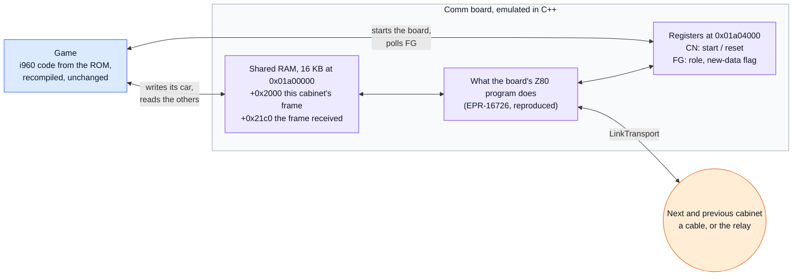
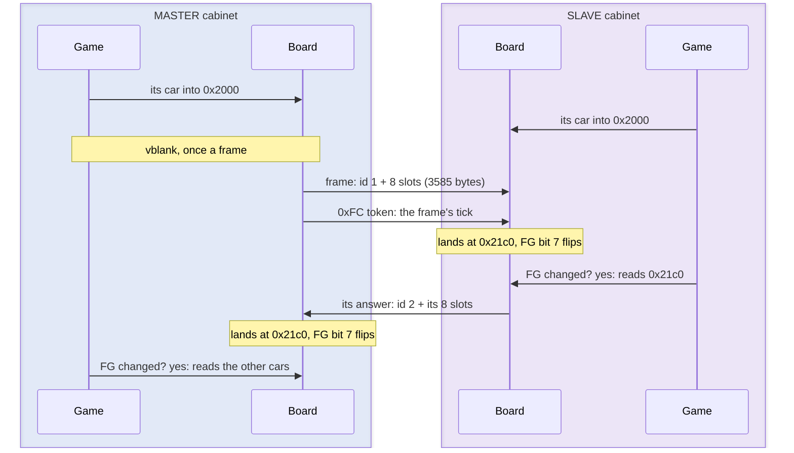
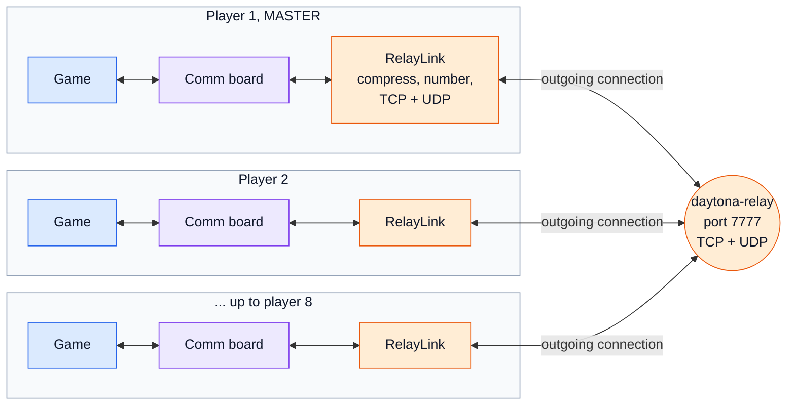
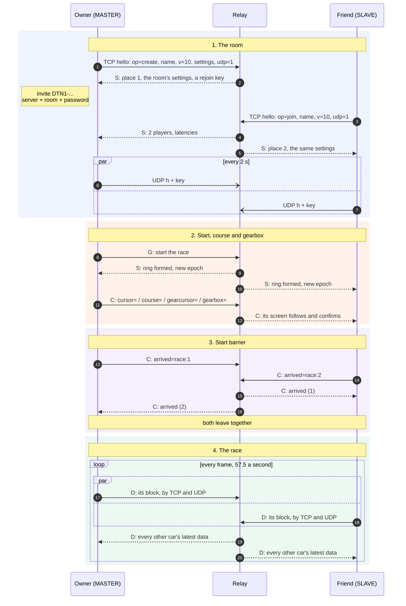
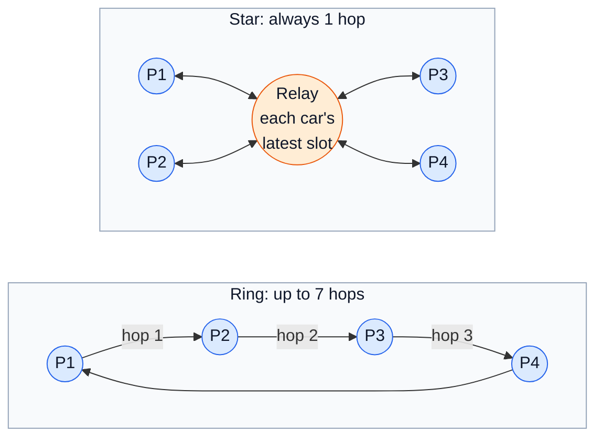
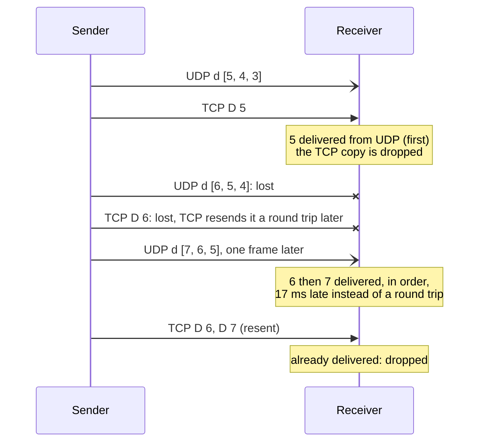
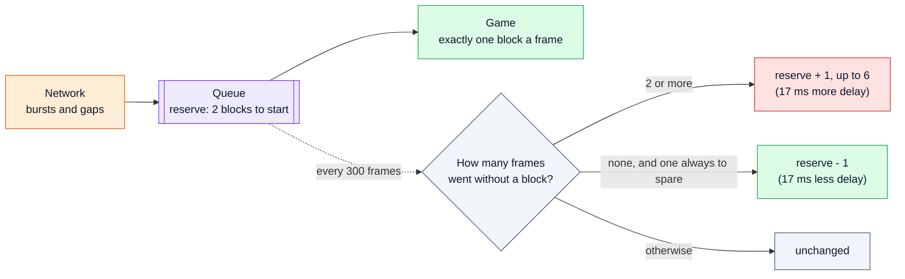
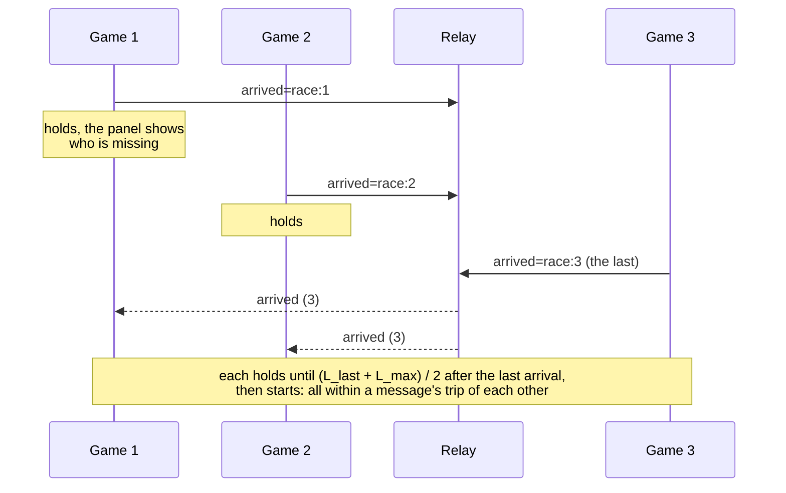
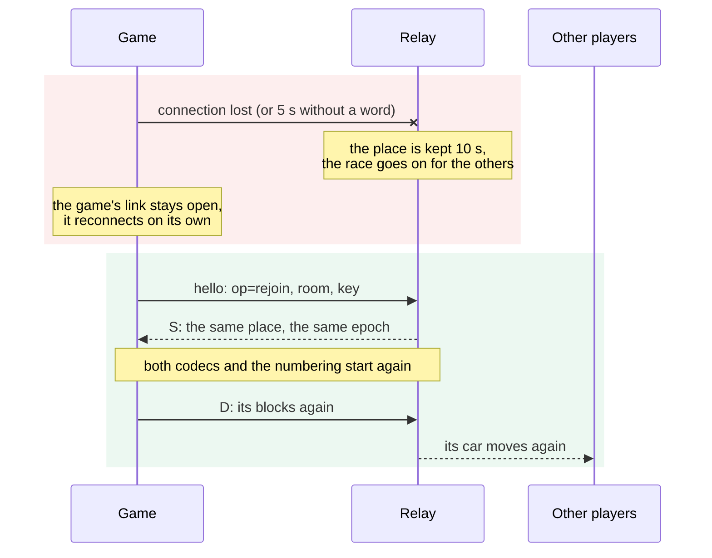

# How the Online mode works

Up to 8 players race Daytona USA (Revision A) over the Internet through a
relay server. The game's own link protocol is kept as it is: the game still
believes it is linked to other cabinets by cable. What changes is how its
data travels. This page explains, for each problem the Internet causes, how
it is solved.

## The starting point: the arcade's link

The arcade links up to 8 cabinets with cables in a **ring**: each cabinet's
communication board sends to the next one and receives from the one before.
Every frame (57.5 a second) each cabinet passes on a block of race data,
3585 bytes (an id and 8 slots of 448 bytes, one per car), and the MASTER
adds a token of the same size: 7170 bytes a frame. The game expects the
block from the cabinet before it within the same frame. On a cable that
takes microseconds; over the Internet a hop takes 20 to 300 ms.

## How the game talks to its link board

The game is the arcade's program, recompiled from the ROM: its i960 code
runs unchanged and talks to the hardware through memory addresses. The
link board (837-10537) has its own Z80 processor running its own program
(EPR-16726). We do not run that Z80 program: `src/runtime/comm_board.*`
reproduces **what it does** (taken from MAME's `m2comm`, its simulation
mode), at the same addresses, so the game cannot tell the difference.

### What the game sees



| Address (as the game sees it) | What it is |
| --- | --- |
| `0x01a00000` + `0x00` | link state: 0 not up yet, 1 up, `0xff` failed |
| `+ 0x01` | the cabinet's role: 1 MASTER, 2 SLAVE, 0 relay |
| `+ 0x02`, `+ 0x03` | this cabinet's link id and the number of cabinets |
| `+ 0x12`, `+ 0x14` | the frame size (`0x0e00`: 8 slots of 448 bytes) and where a received frame lands (`0x01c0`) |
| `+ 0x2000` | **this cabinet's frame**: slot 0 is its own car, the game writes it every frame |
| `+ 0x21c0` | **the frame received** from the cabinet before, one slot further on |
| `0x01a04000`, byte 0: **CN** | the game writes 1 to start the board, 0 to reset it |
| `0x01a04000`, byte 2: **FG** | written: bit 0 is the MASTER flag. Read: bit 7 flips each time a new frame has landed |

The role comes from the cabinet's own settings (test menu > GAME SYSTEM >
LINK ID: MASTER or SLAVE), which online come from the room (section 2).

### The ring is built into the memory layout

A received frame lands **one slot further on** than the frame the cabinet
sends (`0x21c0` instead of `0x2000`). So when a cabinet sends its frame,
slot 0 is its own car, slot 1 is the car of the cabinet before it, slot 2
the one before that, and so on: every hop round the ring shifts every car
one slot. After 7 hops, every cabinet has every car's data. This is why, in
the arcade's ring, slot `j` holds the car `j` places behind, `j` hops old
(section 3 replaces that).

### One frame on the link



The game waits for the FG flip every frame: its vblank interrupt reads FG
first (the reference), then the game's main loop reads it until it
changes. A frame where it does not change is a frame where the other cars
do not move. This is the point every later section protects.

### Bringing the link up

When the game writes CN = 1, the board clears its RAM and numbers the ring.
On the arcade, the MASTER waits about 4 s (232 frames), sends an `0xFF`
token round the ring (each SLAVE adds one: back at the MASTER it is the
count), then an `0xFE` token that hands each cabinet its id. Online the
relay already knows every place, so the board is **preset**: CN = 1 brings
the link up at once with the id and count the relay gave (section 2),
without the tokens going round.

### Talking to the game outside the link

The coordination of section 7 never patches the game's code or its link
data. It only **reads** a few bytes of the game's RAM, the way a test probe
would:

| Address | What it is |
| --- | --- |
| `0x5010a0` | the game's mode: attract, WAITING FOR YOUR ENTRY (16), selection (18), the last screen before the race (21), the race (22) |
| `0x5010f8` | the selection's step (course, gearbox) |
| `0x501460` | the course under the cursor |
| `0x501464` | the gearbox chosen |

and it acts only as a player would: it **presses** Start, steers the
cursor and presses the pedal to confirm, through the cabinet's inputs. The
room's settings are written into the cabinet's settings EEPROM before the
game boots, as an operator would set them in the test menu.

## The pieces



| Piece | Where | What it does |
| --- | --- | --- |
| Game | generated code | Runs the arcade program; writes its block into the comm board's shared RAM and reads the others' |
| Comm board | `src/runtime/comm_board.*` | The link board's protocol: ring places, tokens, blocks; hands the blocks to the game at a steady pace |
| RelayLink | `src/app/relay_link.*` | The connection to the relay: compresses, numbers and sends the blocks by TCP and UDP; reconnects |
| Coordination | `src/runtime/online_settings.h` | The room's settings, one Start, the start barrier, the MASTER's course and gearbox |
| Relay | `server/daytona-relay` | Rooms, the ring's order, the star composition, latency, rejoin, logs |

## A race, from the invite to the finish



---

## 1. Reaching each other: a relay server

**The problem.** Players sit behind home routers and CGNAT, which refuse
incoming connections. Cabinets linked directly would need ports opened on
every router, and many players cannot open them at all.

**The solution.** Every game connects **out** to one server, the relay,
which passes the data between the players of a room. Only the server needs
a port open: 7777, TCP and UDP.

**In detail.** One TCP connection a player, opened with a text line, the
**hello**:

```
DAYTONA-RELAY 5 op=join room=k7f3q9xz name=Alex pass=... v=10 udp=1
```

- `op`: `create` (the creator owns the room), `join`, `info` (the server's
  default settings, then it closes) or `rejoin` (back after a drop).
- `v`: the game's **online version** (`kOnlineVersion`). A room only takes
  games of the version that created it, so every player behaves the same.
- `udp=1`: the race data also goes by UDP (section 4).

Then both sides exchange **frames**: `type (1) | epoch (4) | length (2) | payload`.

| Type | Direction | Payload |
| --- | --- | --- |
| `D` | both | one comm-board block, compressed (with a 4-byte sequence number first when `udp=1`) |
| `S` | server → player | the room: players, places, names, race settings, each player's latency, the rejoin key |
| `C` | player → others | the games' coordination: start barrier, course, gearbox |
| `G` | owner → server | start a race with everyone in the room |
| `P` / `O` | both | a ping every 2 s with a time stamp and its answer: the round trip is the latency shown in the room |
| `E` | server → player | a refusal code (`full`, `password`, `game_version`...) the game shows in the player's language |
| `I` | server → player | the answer to `op=info` |

The **epoch** numbers the room's ring. It changes whenever the ring changes
(a race starts, someone leaves), and data carrying an old epoch is dropped:
a block from the last race never reaches the next one.

The **invite code** `DTN1-XXXXX-XXXXX-...` carries the server, the room and
its password in Crockford base32 with a CRC-16: it can be read aloud, typed
in either case, pasted with or without dashes, and a cut or mistyped code
is refused.

## 2. The same cabinet settings for everyone

**The problem.** The arcade cancels a link whose cabinets disagree on their
settings (difficulty, game mode, cabinet type, country...). Each player's
game keeps its own settings.

**The solution.** The room's settings come from the relay, and every game
writes them into its cabinet before the race.

**In detail.** The `S` frame carries them as bytes of the cabinet's
settings EEPROM (`eeprom=19:00,1a:01,1b:00,...`); the server only accepts
the race settings' offsets. The relay also gives each game its place in the
ring, so the comm board brings the link up at once with that id instead of
the arcade's numbering token round the ring, which waits several seconds
and one round trip per cabinet. The cabinet's test menu (F2) is locked
online, so nobody changes a setting mid-race.

## 3. Old data: a star instead of a ring

**The problem.** In the ring, a block's slot `j` holds the data of the
cabinet `j` places behind its sender, passed on `j` times. Through a server
each pass is a round trip: with 8 players, the car behind you arrives up to
7 hops old.

**The solution.** In **star mode** the relay decodes every block it
receives, keeps each player's own slot, and composes for each player a
block where every other car's slot is that car's **latest** data: one hop
old, whatever its place.



**In detail.** The game notices nothing: it still receives one block a
frame "from the cabinet before it", in the arcade's format. The relay runs
the game's codec in Go (`linkcodec/`), byte-identical to the game's (a test
checks it), with one codec state per direction per player. The other cars
are seen about half your round trip plus half theirs late; with 4 players
from Brazil through a relay in Europe, the farthest car is 0.4 s old
instead of 1 s.

## 4. Bandwidth: compression

**The problem.** 7170 bytes a frame (the block and the token) at 57.5
frames a second is 3.3 Mbit/s each way per player, and the relay carries
the room's sum.

**The solution.** Most of a block repeats from one frame to the next, so
only the differences travel (`src/app/link_codec.h`, the same in
`linkcodec/linkcodec.go`).

**In detail.** Each message starts with its kind:

- `0x00` raw: the frame as it is (rare);
- `0x01` token: the board's tokens, a length and one byte;
- `0x02` block: for each 448-byte slot, a reference to the same slot in one
  of the two previous blocks (or to zeros), then only the bytes that
  differ, XORed, as runs of zeros and literals.

| Players | Bytes a frame, on average (instead of 7170) |
| --- | ---: |
| 2 | 121 |
| 4 | 197 |
| 8 | 323 |

About **0.1 to 0.3 Mbit/s** each way per player, instead of 3.3.

## 5. Packet loss: TCP and UDP together

**The problem.** TCP delivers everything in order, but one lost packet
holds everything behind it until it is sent again, at least one round trip
later: the other cars freeze, then jump. UDP has no such wait, but loses
packets and is blocked on some networks.

**The solution.** Every race message travels **both ways at once**: in its
TCP frame and in a UDP datagram. A frame's messages (the block and the
token) share one datagram, which also **repeats the two messages before
them**. The receiver takes each message **once, in order, from whichever
path brings it first**.



**Why two repeats.** Measured with 8 players at 100 ms: with 2% random
loss the TCP copy already covers most lost datagrams (the worst player
96.7% smooth without repeats, 96.3-99.4% with two); with loss in bursts, as
on Wi-Fi, the repeats are what keeps the cars moving (worst player 96.2%
without, 98.1% with two). Each repeat costs traffic: the relay sends about
0.46 Mbit/s a player with two, 0.33 without (`DAYTONA_UDP_REPEAT`).

**In detail.** With `udp=1`, every `D` message carries a 4-byte sequence
number, which restarts with each epoch. A datagram is `d`, the epoch, a
count, then each message as `seq (4) | length (2) | message`, newest first,
under 1200 bytes so it is never fragmented. A lost datagram is covered by
the next one, a frame (17 ms) later, instead of by a TCP retransmission.
Messages that arrive ahead of a missing one wait (up to 64) until it comes.
Every 2 s the game sends an `h` datagram with its key, so the relay knows
its address and the router keeps the path open. If UDP is blocked, TCP
alone carries everything.

## 6. Irregular arrival: pacing with a reserve

**The problem.** Over the Internet blocks do not arrive one per frame: two
land in the same frame, then none in the next. The game reads one block per
frame; with an uneven arrival it misses logic ticks (24 to 56% of them with
4 players at 100 ± 15 ms), and the other cars stutter.

**The solution.** The comm board holds arriving blocks in a queue and hands
the game **exactly one per frame**, with a **reserve** of blocks kept back
to cover the gaps. The reserve adapts to the line.



An example, with the reserve at 2:

| Frame | 1 | 2 | 3 | 4 | 5 | 6 |
| --- | --- | --- | --- | --- | --- | --- |
| Blocks arriving | 2 | 0 | 1 | 2 | 0 | 1 |
| Without pacing, the game sees | FG flips twice: **nothing** | **nothing** | new data | FG flips twice: **nothing** | **nothing** | new data |
| With pacing, the game gets | 1 block | 1 block | 1 block | 1 block | 1 block | 1 block |
| Blocks left in the queue | 3 | 2 | 2 | 3 | 2 | 2 |

**In detail.** Each block's arrival is shown to the game at its next read
after the frame's vblank, never two in one frame; if the queue grows too
long, the oldest block goes in silently so the delay does not build up.
Each block of reserve costs about 17 ms of delay on the other cars' data,
which is why the reserve shrinks again when the line is steady. Each game
also sends its block and the board's token **in one send** per frame,
instead of two.

## 7. Everyone at the same moment: coordination

The arcade's link settles who starts, which course and which gearbox
between cabinets a cable apart. Over long round trips those exchanges take
seconds, and the games disagree. The games settle them with their own `C`
messages, which the relay passes to everyone else in the room.

| Message | From | What it does |
| --- | --- | --- |
| `G` frame, then automatic entry | owner | Only the owner starts a race (unless the server lets anyone); the other games answer the cabinet's WAITING FOR YOUR ENTRY on their own |
| `cursor=N`, `course=N` | MASTER | The others' course cursor follows the MASTER's and confirms when it confirms |
| `gearcursor=N`, `gearbox=N` | MASTER | The same for the gearbox screen |
| `arrived=RACE:PLACE` | each game | The start barrier, below |

### The start barrier

**The problem.** The games run at full speed, each on its own clock, and
reach the race at different moments: the MASTER's selection waits for the
others' answers, and it could start several seconds after them.

**The solution.** Each game, on reaching the last screen before the race,
tells the room `arrived=` and **holds** until every game of the race has
arrived; then all start together.



**In detail.** While a game holds, its comm board keeps ticking (a game
still selecting needs the held ones' answers), and a panel shows who it
waits for. The relay measures every player's latency `L`; the last to
arrive tells the room, and its word reaches player `p` about
`(L_last + L_p) / 2` later, so each game holds until
`(L_last + L_max) / 2` after the last arrival: **all start within a
message's trip of each other** (36 ms apart with 8 players on a local
relay). After 15 s the race starts anyway, and a late player joins it as
its game arrives.

### No pause online

**The problem.** The others' games depend on yours answering the link
every frame; a paused game stops the whole room.

**The solution.** Online, Esc opens the menu over the race and the game
keeps running behind it.

## 8. A dropped connection: rejoin

**The problem.** A connection that drops mid-race would end the race for
everyone, since the ring is broken.

**The solution.** The relay keeps the player's place for **10 s** while the
race goes on; the game reconnects on its own with a key and takes its
place back.



**In detail.** The key comes in the `S` frame and is compared in constant
time. Five seconds without a word from the server (it pings every 2 s)
count as a drop. After 10 s without the player, the place is released and
the room waits for the owner's next race.

---

## Results

Headless games (`m2run --realtime`), 0.15.0, one race each:

| Scenario | Frames where the other cars moved smoothly | Other cars' data age | Game speed |
| --- | --- | --- | --- |
| 8 players, local relay | 99.7-99.9% | 47 ms | 100% |
| 8 players, relay in Brazil, over the Internet (~85 ms) | 99.4-99.8% | 138 ms | 100% |
| 4 players, 230 ms added (a relay in Europe, from Brazil) | 98.8-99.4% | 272 ms | 100% |
| 8 players, 230 ms added | 83.5-99.4% | 276 ms | 100% |

**Known limit:** with 8 players and a distant server, the players other
than the MASTER receive fewer messages a second (81 to 101 instead of 115)
and some stutter. Pick a server close to every player.

## Limits and safety

- Up to 8 players a room. A server caps connections, connections and rooms
  per address and rooms in all; it rate-limits each connection (a player
  who floods is disconnected, not the others), closes idle rooms, slows
  down whoever keeps trying wrong room codes or passwords, and takes a
  player's datagram address only from that player's own connection
  (`server/daytona-relay/README.md`, "Abuse limits").
- The connection is **not encrypted**: race data is not sensitive, but a
  room's password travels in clear.

## Logs

Each game writes `daytona.log` (Settings > Game > Logs), with UTC times on
its online lines and one line per race: game speed, how smoothly the other
cars moved, the reserve, messages a second, what UDP brought first. The
relay logs each race's players every minute and at its end: messages in and
out, latency, its longest send queue, drops and returns. Both are matched
by room, name and time.

## Where the code is

| Topic | Game | Relay |
| --- | --- | --- |
| The link board the game sees (addresses, ring, tokens) | `src/runtime/comm_board.*`, `src/runtime/m2_board.cpp` (the map) | |
| Frames, hello, status, invite | `src/app/online.*` | `proto/proto.go` |
| Connection, UDP, rejoin | `src/app/relay_link.*` | `cmd/daytona-relay/main.go`, `udp.go` |
| Compression | `src/app/link_codec.h` | `linkcodec/` |
| Star composition | | `main.go` (`compose`) |
| Pacing, reserve | `src/runtime/comm_board.*` | |
| Settings, Start, barrier, course, gearbox | `src/runtime/online_settings.h` | |
| Race logs | `src/app/online_race_stats.h` | `cmd/daytona-relay/racelog.go` |

The exact byte formats are also described in
[`server/daytona-relay/README.md`](../server/daytona-relay/README.md#protocol).
