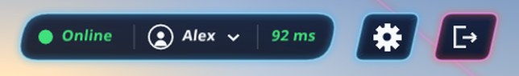
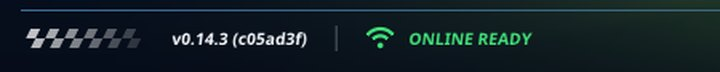
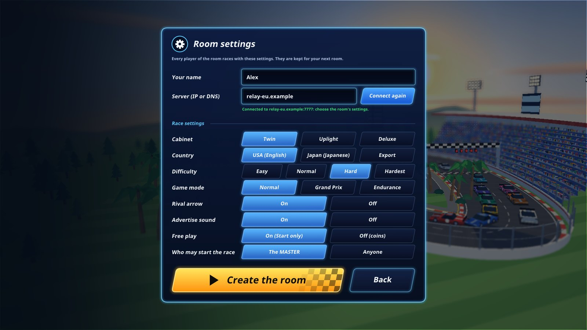
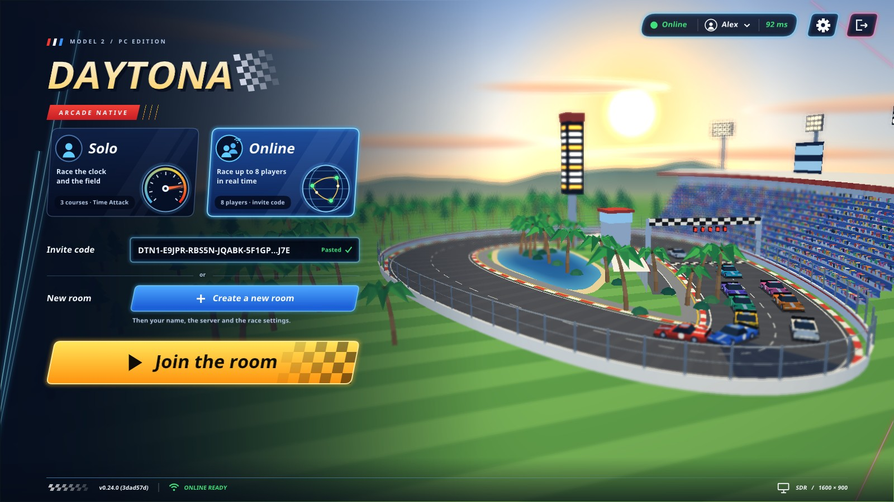
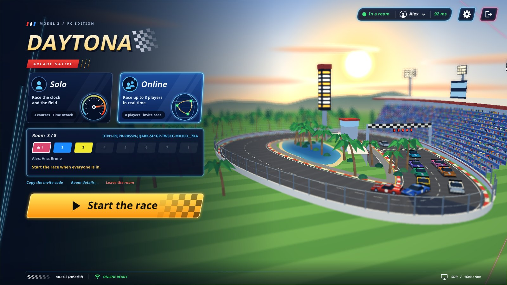
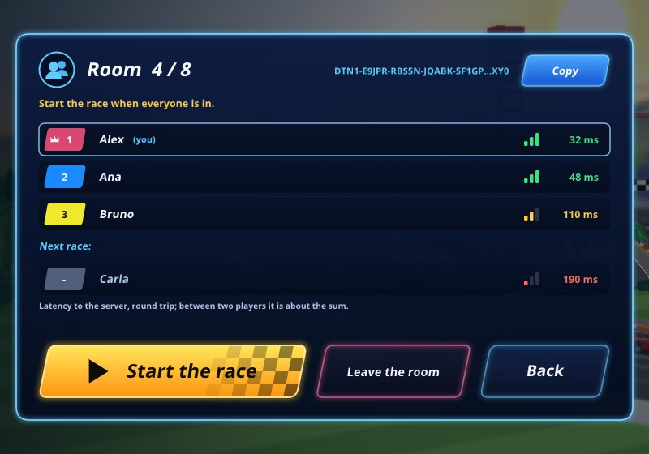
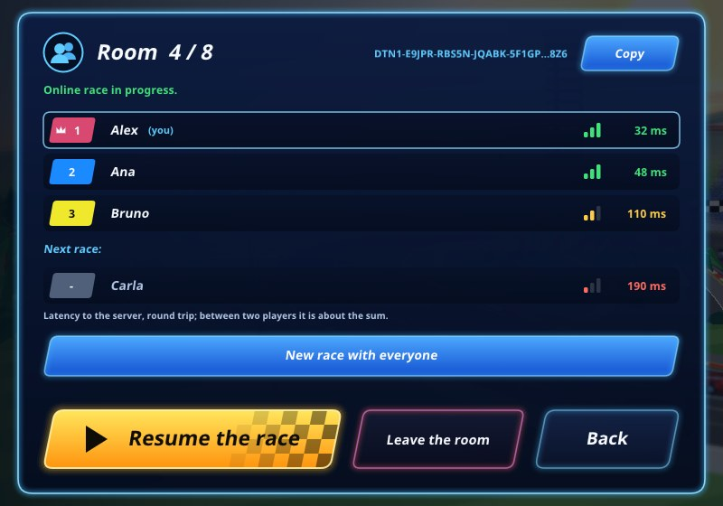

# Playing online

Race your friends over the Internet, up to 8 players a room. This guide
walks through it step by step, from the home screen.

## What you need

- **The game, version 0.14 or later**, built from your own ROM set
  (Revision A, `daytona`): see [BUILDING.md](BUILDING.md). Every player of
  a room needs the same online version (the bottom bar shows it).
- **A relay server.** One person runs it (Docker, a small VPS or a home
  computer); everyone else only needs its address, and nobody opens a port
  on their own router. To run one, see
  [server/daytona-relay](../server/daytona-relay/README.md): open port
  **7777, TCP and UDP**, on the server.
- **A name.** The other players see it in the room's list and above your
  car.

## The top of the home screen

- **The dot and the word**: the server you used last answers (**Online**),
  does not (**Offline**), runs another version (**Other version**), or is
  being asked (**Testing...**). **In a room** once you are in one.
- **Your name**: click it (▾) to change it.
- **The latency**: the round trip to the server, in milliseconds.

The bottom bar says **ONLINE READY** when you have a name, a server, and
the server answered; otherwise it says what is missing (**SET A NAME**,
**NO SERVER**, **SERVER OFFLINE**, **VERSION MISMATCH**).

## 1. Create a room (one player)

On the home screen, choose the **Online** card, then **Create a new room**.

1. **Your name**: type it first; **Connect** stays off without one.
2. **Server**: its address (a name or an IP; add `:port` only when it is not
   7777), then **Connect**. The line under it turns green when the server
   answers. If the server has a password, a field for it appears.
3. **Race settings**: every player of the room races with them, so pick
   them for everyone: cabinet, country (the game's language), difficulty,
   game mode, rival arrow, advertise sound, free play, and who may start
   the race. They are kept for your next room.
4. **Create the room**.

Back on the home screen you are in the room: use **Copy the invite code**
and send the code (it starts with `DTN1-`) to your friends, by chat or
e-mail. It holds the server, the room and the password, so they type
nothing else.

## 2. Join a room (the others)

1. **Copy the invite code** you received.
2. Open the game and choose the **Online** card: the code is pasted on its
   own (**Pasted**). If not, paste it in the **Invite code** field.
3. **Join the room**. The first time, the game asks for your name.

## 3. In the room

- The eight places show who is in, each in their car's colour; the room's
  owner (who created it) wears a crown, and yours is outlined.
- The line under them says what the room waits for.
- **Room details...** lists every player with their latency to the server:
  green up to 60 ms, yellow up to 120 ms, red above. Between two players
  the delay is about the sum of theirs. Who joined during a race waits for
  the next one, under **Next race**.

- **Leave the room** takes you out; pressing **Play** on the Solo card asks
  first.

When everyone is in, the owner presses **Start the race**.

## 4. The race

- The owner presses **Start** (Enter, or the gamepad's Start) and chooses
  the course; the other games follow. Each player chooses their own
  gearbox.
- **Tab** (or the gamepad's left stick button) shows the players list with
  the live standings; each player's name also floats above their car.
- **Esc** opens the room's details: **Resume the race** goes back in,
  **Leave the room** ends it for you.

- When the race ends, the games stay linked: the owner presses Start again
  for the next one. Who joins during a race waits for the next one; the
  owner can start a **New race with everyone** from **Room details...**.
- If your connection drops, the game reconnects on its own and you keep
  your place, for up to 10 seconds.

## When something goes wrong

| What you see | What to do |
| --- | --- |
| **SET A NAME** / Connect is off | Type your name (the ▾ at the top, or the room's settings). |
| **SERVER OFFLINE**, or "connection lost" | Check the server's address; on the server, check that it runs and that port 7777 TCP is open. |
| **VERSION MISMATCH** / "not compatible with this version" | Every player and the server need the same version: update and build again. |
| "This room does not exist" | The code is incomplete, or its creator left: ask for a new code. |
| "This room was created by another version of the game" | Everyone in a room needs the same game version. |
| The other cars jump or lag | Look at the latencies in **Room details...**: a server close to every player helps most. Port 7777 UDP open on the server helps through packet loss. |

More about the server, its settings and the protocol:
[server/daytona-relay/README.md](../server/daytona-relay/README.md).
